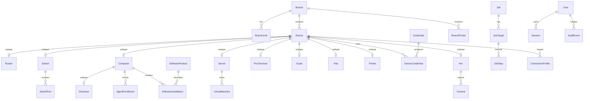
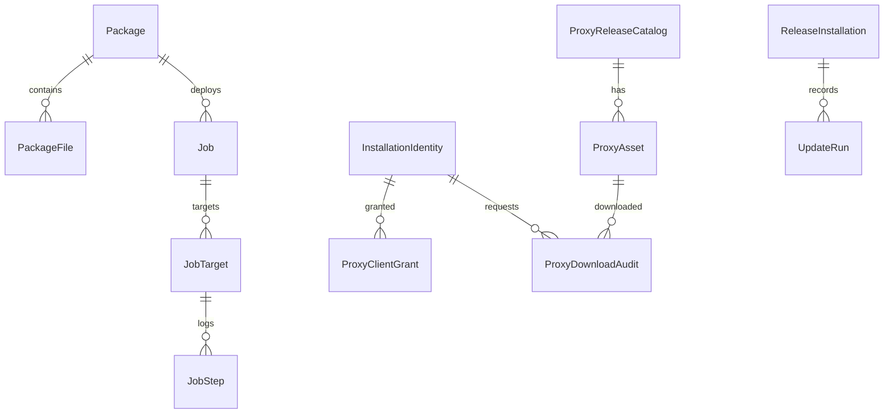

# Initial database design — proposed, not a migration

## Conventions
PostgreSQL, Prisma, UUID primary keys, timestamptz in UTC, created_at and updated_at on mutable records, optimistic version where concurrent edits matter. Soft-delete operational assets using deleted_at; never cascade-delete operational history. Explicit nullable fields, constraints and enum checks are finalized in schema review. Secret ciphertext is never returned by general APIs. IP addresses use PostgreSQL inet or validated canonical text with a consistent Prisma mapping; document native-type limitations. Enforce IPv4/IPv6 and uniqueness according to management network/namespace rather than globally if networks can overlap. Time-zone aware user display. All text lengths and numeric ranges validated in both API and database.

## ERD

## Entity catalog (all IDs UUID unless otherwise stated)
* **Branch**: id; branch_id and warehouse_id business identifiers; name; manager/phone, deputy/phone, description, status, deleted_at. Unique active branch_id; warehouse uniqueness requires confirmation.
* **BranchLink**: branch_id FK; name, provider, connection_type, wan_ip, gateway, bandwidth, status, description, deleted_at; unique active (branch_id,name). Multiple links independent of router.
* **Device**: branch_id FK; kind; name; management_ip; vlan; description; status (online/offline/unknown); last_seen; deleted_at. Device kind consistent with exactly one matching subtype, enforced by transactional service and, where practical, deferred database triggers; distinct VM/camera subtype references need explicit mapping. Prefer constrained relations over a polymorphic foreign key. Status unknown is distinct from inactive/removed.
* **Router**: device_id PK/FK; vendor, model, port, credential associations via DeviceCredential. Each branch's designated monitoring router is represented by **BranchMonitorTarget**: branch_id PK/FK, router_device_id FK; enforce target's branch matches branch. Router count is not restricted.
* **Switch**: device_id PK/FK; vendor, model, location, connection_type. **SwitchPort**: id, switch_device_id FK, port_number text, status, vlan, connected_ip, connected_device_id nullable FK, description, additional_details; unique (switch_device_id,port_number) among active ports. Manual maintenance is authoritative.
* **Computer**: device_id PK/FK; hostname, username nullable, domain, computer_type client/checkout, agent summary derived from latest authenticated heartbeat, description. Unique hostname within a normalized domain/namespace for active computers; allow null domain for non-domain machines. **Checkout**: computer_device_id PK/FK, vendor, printer_device_id nullable FK to Printer. Clients are computers with client type; validate checkout subtype/type agreement.
* **Server**: device_id PK/FK; vendor, model, ilo_ip, esxi_version. Multiple per branch. **VirtualMachine**: device_id PK/FK; hostname, domain, server_device_id FK. Cross-branch host policy needs approval; default enforce same branch.
* **Nvr**: device_id PK/FK; vendor, model, port, username, firmware_version, last_sync_at, last_sync_status, last_sync_error sanitized. **Camera**: device_id PK/FK; nvr_device_id FK, channel_number, last_sync_at, lifecycle active/inactive/removed, last_seen. Unique (nvr_device_id,channel_number) among active channels; do not delete disappeared records. Replacement identity/history rules require firmware testing.
* **PosTerminal**: device_id PK/FK; vendor, model, firmware, terminal_id, acceptance_id, serial_number. **Scale**: device_id PK/FK, vendor, model, serial_number, stall. **Pda**: device_id PK/FK, model, section. **Printer**: device_id PK/FK, vendor, model, section. Serial/terminal unique constraints scoped by vendor or organization only after data cleanup and policy approval.
* **User**: normalized unique username, Argon2id password_hash, role enum admin/operator/viewer, status, auth_epoch, created/updated. **Session**: user_id FK, hashed opaque token, expires_at, revoked_at, last_seen, creation metadata; no raw session token. **RecoveryCode**: user_id FK, secure hash, expires_at optional, consumed_at; one-time consume in locked transaction. Require rate limits and audit.
* **Credential**: name, username, domain, category, description, ciphertext, nonce, auth_tag, wrapped_key_version, deleted_at; unique active name/category as policy dictates. **DeviceCredential**: composite unique (device_id, credential_id), optional usage label. Multiple credentials per device; foreign keys restrict deletion when required.
* **AgentEnrollment**: computer_device_id FK; agent_id, public key or secret verifier, issued_at, revoked_at, version, executable SHA-256, heartbeat_at, health; permit enrollment rotation and historical records; unique current active agent per computer. **AgentTask**: job_target_id FK, task_type, schema_version, validated structured parameters, nonce, expiry, authorization, state, timestamps, result sanitized; no unrestricted scripts.
* **SoftwareProduct**: normalized publisher/name/product identity, optional platform identifier; **SoftwareInstallation**: computer FK, product FK, source, version, architecture, observed_at, removed_at; stable Windows registry source/key identity and machine/user scope; unique current source identity per computer; store scan timestamp separately so stale results are distinguishable. **SoftwareScan** tracks run outcome, errors and freshness. Compare versions via ecosystem-specific parsers, otherwise report uncomparable, not lexicographic as fact.
* **BranchProbe**: branch_id FK, router_device_id FK, observed_at, result, duration_ms, error_class; indexed (branch_id,observed_at DESC), optional time partitions at scale. **MonitoringConfig**: intervals, timeout, retries, retention, concurrency limits and enabled; checks on safe bounded values. **Alert**: severity, source, state, timestamps, deduplication key; **OperationalEvent** records operational summaries.
* **Job**: type, scope, creator_user_id, policy, state, idempotency_key unique per caller/operation, created/start/finish times, cancellation flag. **JobTarget**: job_id, device_id, state, attempt count, error_class, last heartbeat and lease fields; unique (job_id,device_id). **JobStep**: job_target_id, sequence, name, state, start/end, sanitized result, source/destination hashes as relevant; append-only attempts. Leases claimed with row locks/SKIP LOCKED; expired leases recover, but side effects must be idempotent or reconciled.
* **Package**: id, original filename, safe folder name, storage reference, size, SHA-256, owner, created_at, state; **DeploymentApproval**: job_id, approver_user_id, reason, acknowledged risk, timestamp. Packages are access-controlled and stored outside web root. The owner-approved destination is the date-only directory recorded on each deployment target; Package Folder Name is metadata, not a nested path.
* **ConnectionProfile**: device_id FK, protocol, port, display name, credential_id nullable FK, options (nonsecret), created_by; **RemoteSession**: profile_id, user_id, started/ended, outcome, sanitized reason; no session payload by default. **TerminalSnippet**: owner, name, command text, sharing/access policy; treat as sensitive operational content; no embedded passwords.
* **NvrSyncRun**: nvr FK, job_target FK, started/finished, outcome, sanitized error and protocol metadata; store channel reconciliation observations in a child record if required for diagnostics.
* **AppSetting**: key PK, typed validated nonsecret JSON, updated_by, version, updated_at; encrypted settings use Credential rather than plaintext. **AuditEvent**: immutable id, occurred_at, actor_user_id nullable, actor type, action, object type/id, outcome, request/correlation id, source and sanitized metadata. Restrict modification/deletion; consider external export and integrity protection. **ReleaseInstallation**: version, channel, full commit, build id, manifest hash, installed_at, status. **UpdateRun**: actor, from/to version/channel, stages, hashes, backup reference, result and rollback status. **FileImport** and **ImportRow**: actor, source checksum, preview state, row number, sanitized validation issues, commit state; **ExportRun** optionally records actor, filter and artifact metadata.

## Indexes and consistency
FK columns are indexed based on query patterns. Add indexes Device(branch_id,kind,deleted_at), computer normalized domain/hostname, Device(status), AgentEnrollment(computer_device_id,heartbeat_at), SoftwareInstallation(product_id,version,removed_at), Credential(category,deleted_at), Job(state,created_at), JobTarget(state,lease_until), AuditEvent(occurred_at DESC), AuditEvent(object_type,object_id,occurred_at DESC), NvrSyncRun(nvr_device_id,started_at DESC), RemoteSession(user_id,started_at DESC), Camera(nvr_device_id,lifecycle). PostgreSQL partial unique indexes for active rows may require custom SQL migrations beyond Prisma. Status updates, audit records, import commits, credential binding and job creation occur transactionally. Avoid holding transactions during network operations.

## Retention and migration
No values are hardcoded: propose operator-configured probe, operational and audit retention, with explicit defaults approved by owner; retain audit under policy and protect against accidental deletion. Purge or anonymize through audited jobs; backups observe same policy. Keep software scan history and removed cameras per approved retention, preserve deployment and credential access history. Prisma checked-in forward migrations, reviewed SQL for constraints/partial indexes, staging rehearsals and restore tests. Expand/contract for compatibility, backup before migration, schema/version gates and advisory migration lock. No automatic destructive migrations; explicit review and recovery plan. Rollback binaries only when schema compatibility is established; otherwise restore consistent database and file backup with stated data-loss window, or forward-fix. PostgreSQL major upgrade is separately planned and tested.

## Expanded relationship map — proposed
The earlier ERD is a high-level view; this map covers supporting operational entities as well. Physical schema and exact Prisma support are not validated.

```mermaid
erDiagram
  Branch ||--o{ BranchLink : has
  Branch ||--o{ Device : contains
  Branch ||--o| BranchMonitorTarget : configures
  Router ||--o{ BranchMonitorTarget : probes
  Branch ||--o{ BranchProbe : records
  Router ||--o{ BranchProbe : target
  Device ||--o| Router : is
  Device ||--o| Switch : is
  Switch ||--o{ SwitchPort : has
  Device o|--o{ SwitchPort : connected_to
  Device ||--o| Computer : is
  Computer ||--o| Checkout : is
  Printer o|--o{ Checkout : serves
  Device ||--o| Server : is
  Server ||--o{ VirtualMachine : hosts
  Device ||--o| VirtualMachine : is
  Device ||--o| Nvr : is
  Nvr ||--o{ Camera : reports
  Device ||--o| Camera : is
  Device ||--o| PosTerminal : is
  Device ||--o| Scale : is
  Device ||--o| Pda : is
  Device ||--o| Printer : is
  Device ||--o{ DeviceCredential : bound
  Credential ||--o{ DeviceCredential : used_by
  Computer ||--o{ AgentEnrollment : has
  AgentEnrollment ||--o{ AgentCredential : authenticates
  AgentEnrollment ||--o{ EnrollmentTicket : lifecycle
  AgentEnrollment ||--o{ AgentTask : receives
  Computer ||--o{ SoftwareScan : scanned
  Computer ||--o{ SoftwareInstallation : contains
  SoftwareProduct ||--o{ SoftwareInstallation : describes
  User ||--o{ Session : owns
  User ||--o{ RecoveryCode : owns
  User ||--o{ AuditEvent : acts
  User ||--o{ Job : creates
  Job ||--o{ JobTarget : includes
  Device ||--o{ JobTarget : target
  JobTarget ||--o{ JobStep : records
  JobTarget ||--o{ AgentTask : generates
  Job ||--o{ DeploymentApproval : approvals
  Package ||--o{ Job : input
  Nvr ||--o{ NvrSyncRun : synced
  JobTarget ||--o| NvrSyncRun : executes
  NvrSyncRun ||--o{ NvrChannelObservation : observes
  Device ||--o{ ConnectionProfile : connects
  Credential o|--o{ ConnectionProfile : selected
  ConnectionProfile ||--o{ RemoteSession : starts
  User ||--o{ RemoteSession : initiates
  User ||--o{ TerminalSnippet : owns
  User ||--o{ BridgeEnrollment : pairs
  BridgeEnrollment ||--o{ BridgeRequest : authorizes
  User ||--o{ FileImport : submits
  FileImport ||--o{ ImportRow : previews
  User ||--o{ ExportRun : exports
  User ||--o{ UpdateRun : initiates
  ReleaseInstallation ||--o{ UpdateRun : from_or_to
```

## Additional logical entities and invariant detail
* **AgentCredential**: enrollment_id FK, credential_id, public key/certificate serial, issued/expires/revoked timestamps, key status; unique certificate serial and fingerprint; partial unique single active principal per computer, allowing an explicitly bounded rotation overlap. Credentials do not store private keys. **EnrollmentTicket**: computer FK, job target FK nullable, unique hashed ticket, expires_at, consumed_at, creator, assigned device identity; atomic compare-and-consume with row lock, no raw ticket retained. A ticket may precede an AgentEnrollment, so diagram relationship represents eventual association, not a mandatory FK at issuance.
* **BridgeEnrollment**: owner_user_id, machine/session binding, public_key, origin, issued/revoked timestamps; unique key fingerprint; **BridgeRequest**: enrollment_id, initiator, request UUID/nonce, target Device FK, operation, created/expiry/redeemed times, outcome; unique request ID, atomic redemption, no bearer capability or credential storage. Exact user-session binding and key format require PoC.
* **NvrChannelObservation**: sync_run_id, normalized channel ID, stable vendor identifier if available, reported status, sanitized name/IP, observation time; unique (sync_run_id,channel_id). Last attempt and last success are separate, missing camera changes only from complete successful snapshot. Field mapping/versioned compatibility is an open question.
* **JobTarget** has lease_owner, lease_until, heartbeat, attempt count; **JobStep** has per-attempt index and ordinal; unique (job_target_id, attempt, ordinal), and records error category/evidence. Agent task unique (agent_id, nonce) plus task UUID; expiry and authorization snapshot mandatory. Package/job relation and deployment approvals allow an immutable package hash to be tied to approved targets and workflow.
* **BranchProbe** references the router actually probed and records attempt summary, valid observation vs unknown. **BranchMonitorTarget** uses branch PK and router FK; same-branch invariant enforce via composite FK `(branch_id,router_device_id)` against router/device mapping or reviewed database trigger, not solely a UI rule. 
* **Alert**, **OperationalEvent**, **AppSetting**, **MonitoringConfig**, **ReleaseInstallation**, **UpdateRun**, **FileImport**, **ImportRow** and **ExportRun** are defined in the preceding catalog. Their scope references use explicit typed nullable foreign keys where feasible; if audit has a generic object reference, retain immutable snapshot identifiers without pretending it is a database FK.
* PK/FK delete rules default RESTRICT/NO ACTION for durable operations; soft deletion of a device does not delete probes, audit, camera history or job results. Update/delete of audit records forbidden to app roles; privileged DB administrators remain a risk. Enforce one exact subtype matching `Device.kind` using reviewed deferred constraint triggers or a schema alternative; define data migration and tests, since a simple FK alone cannot enforce this. Composite FK enforces printer/server/device branch rules when selected; cross-branch VM rule awaits owner decision. Case-insensitive normalized identifiers use deterministic normalization and partial unique indexes; nullable domain requires explicit unique null policy rather than relying on ordinary PostgreSQL NULL uniqueness.
* BranchLink, SwitchPort and camera statuses are modeled independently. IP uniqueness must be scoped to a defined network namespace, not globally; network namespace table/foreign key is required before enforcing that scope, and overlap and NAT rules await discovery. Fields omitted from an input remain null where allowed, not invented. Port numeric constraints 1–65535; SHA-256 stored as 32-byte binary or validated 64 hex; positive bandwidth, attempts, durations and valid ranges; timestamps UTC and monotonic transitions enforced by domain logic. Database checks enforce constraints where representable; API validates entire DTOs.
* Supporting indexes: AgentCredential(enrollment_id,revoked_at), EnrollmentTicket(expires_at,consumed_at), BridgeRequest(enrollment_id,expires_at), JobStep(job_target_id,attempt,ordinal), NvrChannelObservation(sync_run_id,channel_id), SoftwareScan(computer_id,started_at DESC), and partial indexes for unconsumed/unrevoked records; unique constraints are indexes. Size/partition decisions and retention require measured loads.

**Completeness boundary:** this is a complete initial *logical* model of the currently identified entity categories, not a reviewed executable schema. Specific enums, field nullability, referential rules and defaults still require owner confirmation and implementation-time schema review. Additions discovered during compatibility work must preserve requirements and be documented.

## Owner decisions: package and proxy data
Add to **JobTarget**: deployment_date, exact_destination_path, destination_state, with uniqueness/locking policy for conflicting same-day file names. Add to **Package** an operator-supplied `package_identifier` (the requested Package Folder Name) and manifest/file metadata: name, relative path, size, source/destination digests. Associate immutable approved package and date to each target/approval. Identifier is never a folder component; exact path is persisted and reused. A separate **PackageFile** child enables multiple files and hashes, unique by package and normalized relative path; validated paths cannot escape the date directory.

Add **InstallationIdentity**: installation ID, public key or verifier (never private key), status, issued/revoked timestamps and selected channel; **ProxyReleaseCatalog** on the proxy: approved repository ID, tag, full commit, channel, release ID, manifest digest and publication/revocation state; **ProxyAsset**: catalog FK, immutable asset ID, name, byte size, SHA-256, cache-object key, lifecycle; unique release/asset ID and object digest. **ProxyClientGrant** links installation to permitted channels and optional asset scopes, with revocation/expiry; **ProxyDownloadAudit** captures installation, actor where available, release/asset, authorization outcome and request correlation, no tokens. Proxy tables are in the separately hosted proxy's own protected datastore; they are not assumed to share the installed app's database. App **ReleaseInstallation** and **UpdateRun** remain local. Validate release-channel grants for every manifest and download; retain audit/cache according to approved policies, invalidate revoked objects and grants promptly. Keys/secrets are in protected secret store, never these plaintext tables.

The diagram denotes logical relationships across separate trust domains; do not implement cross-database foreign keys. API authorization enforces policy. **User.role** has admin/operator/viewer; if future granular grants are added, **RolePermission** and **UserScopeGrant** model server-side permissions and device/branch scope without relying on UI restrictions. Audit references actor, target and outcome; access and retention policy require owner configuration.
